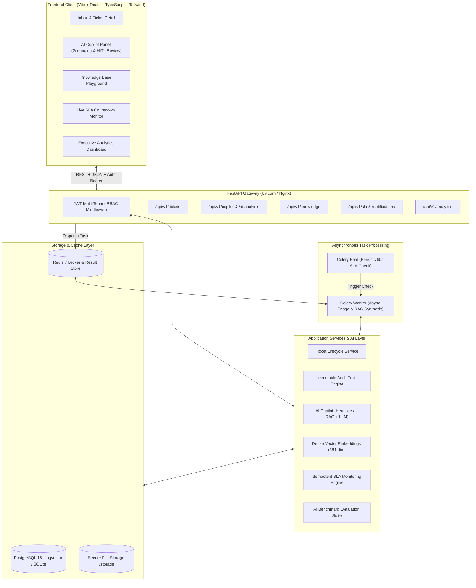

# ResolveAI — Enterprise AI Customer Support Automation Platform

[](https://github.com/resolveai/resolveai/actions/workflows/ci.yml)
[](https://fastapi.tiangolo.com)
[](https://react.dev)
[](https://github.com/pgvector/pgvector)
[](https://docs.celeryq.dev)
[](LICENSE)

**ResolveAI** is a production-oriented, full-stack AI customer support automation and ticket intelligence copilot platform. Designed to eliminate ticket backlogs and reduce first-response latency from hours to seconds, ResolveAI blends high-precision **Retrieval-Augmented Generation (RAG)**, automated ticket triage, multi-tenant RBAC, and real-time SLA deadline monitoring with a strict **Human-in-the-Loop (HITL)** draft review workflow.

---

## 🏛️ System Architecture



---

## 🚀 Key Features

### 1. Grounded AI Copilot with Human-in-the-Loop (HITL)
- **Zero Hallucination Tolerance:** The AI synthesizes responses strictly from retrieved organizational knowledge chunks. Every generated sentence includes an interactive citation referencing the document title and section.
- **Honest Abstention:** If similarity scores fall below the configurable threshold (`SIMILARITY_THRESHOLD=0.35` cosine cutoff), the system abstains honestly and prompts human agents instead of guessing.
- **Human Review & Edit Workflow:** Support agents inspect the suggested reply, edit the draft, or approve/reject it with review comments before it is posted into the customer conversation thread.
- **Prompt Injection Defense:** Customer inquiries and attachments are isolated inside strict XML boundary tags (`<customer_inquiry>`) and system prompts instruct the model to disregard embedded prompt injection instructions.

### 2. Multi-Tenant Role-Based Access Control (RBAC)
- **Data Isolation:** Every database entity (`tickets`, `ticket_messages`, `knowledge_documents`, `sla_policies`, `audit_logs`) is strictly partitioned by `organization_id`.
- **Pre-configured Roles:**
  - `admin`: Full organizational governance, team management, knowledge base curation, and SLA policy editing.
  - `support_manager`: Team oversight, ticket re-assignment, escalation handling, and analytics CSV exports.
  - `support_agent`: Ticket triage, customer responses, draft review, and AI copilot interaction.

### 3. Automated Ticket Triage & Intent Routing
- Automatically extracts **sentiment** (`positive`, `neutral`, `negative`, `urgent`), **priority** (`low`, `medium`, `high`, `critical`), and **category** (`billing`, `refunds`, `technical`, `account`, `orders`, `general`).
- Proactively suggests routing to specialist teams (e.g., *Billing & Finance*, *Technical Escalations*).

### 4. Idempotent SLA Engine & Manager Escalation
- Real-time countdown tracking against policy-defined deadlines for **First Response** and **Resolution**.
- Automated warnings at 30 minutes (first response) and 60 minutes (resolution).
- Automatic escalation to support managers for unassigned tickets that breach SLA thresholds.
- Deduplication via `SLAEvent` database constraints ensures no notification spam occurs on repeated evaluation ticks.

### 5. Enterprise Analytics & Injection-Proof Export
- Key Performance Indicators: Total volume, resolution rate, first-response compliance %, and average handling time.
- Volume distribution by category and priority.
- Agent workload breakdown.
- **CWE-1236 Prevention:** All CSV exports are sanitized against formula injection attacks (cells starting with `=`, `+`, `-`, `@`, `\t`, `\r` are safely escaped).

### 6. Measurable AI Evaluation Benchmark
- Built-in evaluation dataset with 10 labeled real-world support inquiries.
- Measures **Classification Accuracy**, **Precision**, **Recall**, **F1 Score**, and **Inference Latency**.
- Validates grounded reply hallucination rate directly via automated test suite.

---

## 🛠️ Technology Stack

| Layer | Technologies |
| :--- | :--- |
| **Backend** | Python 3.12, FastAPI, Pydantic v2, SQLAlchemy 2.0, Alembic, Psycopg 3 |
| **AI / NLP** | RAG (Retrieval-Augmented Generation), 384-dimensional dense semantic vectors, PyPDF |
| **Worker / Queue** | Celery 5.3, Redis 7 |
| **Frontend** | React 18, TypeScript, Vite, Tailwind CSS, TanStack React Query, Lucide Icons |
| **Database** | PostgreSQL 16 with `pgvector` (production) / SQLite with cosine vector math (local native) |
| **DevOps / CI** | Docker Compose, Multi-stage Dockerfiles, GitHub Actions CI |

---

## ⚡ Quickstart Guide

### Option A: Local Native Execution (Zero Docker Dependencies)

ResolveAI is designed to run locally right out of the box using a local SQLite vector database and deterministic heuristic AI fallbacks (no OpenAI key required!).

#### 1. Prerequisites
- Python 3.11+ (Python 3.12 recommended)
- Node.js 18+ and npm
- `uv` package manager (`curl -LsSf https://astral.sh/uv/install.sh | sh` or `pip install uv`)

#### 2. Backend Setup
```bash
# Clone the repository
git clone https://github.com/resolveai/resolveai.git
cd resolveai

# Setup Python virtual environment
cd backend
uv venv .venv --python 3.12
source .venv/bin/activate

# Install dependencies in editable mode
uv pip install -e ".[dev]"

# Run database migrations / seed script
python -m app.core.seed

# Start FastAPI development server
uvicorn app.main:app --host 127.0.0.1 --port 8000 --reload
```
The API documentation is accessible at `http://127.0.0.1:8000/docs`.

#### 3. Frontend Setup
```bash
# In a new terminal window:
cd frontend
npm install --legacy-peer-deps
npm run dev
```
Open your browser at `http://127.0.0.1:5173`.

---

### Option B: Production Setup with Docker Compose

To deploy ResolveAI with PostgreSQL 16 (`pgvector`), Redis 7, Celery Workers, Celery Beat, FastAPI, and Nginx:

```bash
# Copy example environment configuration
cp .env.example .env

# Build and start all services
docker compose up --build -d

# Verify all containers are healthy
docker compose ps
```
The application will be live at `http://localhost:3000` (Frontend) and `http://localhost:8000` (Backend API).

---

## 🔑 Pre-Seeded Demo Credentials

The database comes pre-seeded with sample data for **Acme Global**:

| Role | Email | Password | Permissions |
| :--- | :--- | :--- | :--- |
| **Administrator** | `admin@acme.com` | `Password123!` | Full admin access, policy management, knowledge base upload |
| **Support Manager** | `manager@acme.com` | `Password123!` | Ticket assignment, SLA escalations, analytics CSV exports |
| **Support Agent** | `agent@acme.com` | `Password123!` | Ticket inbox, AI draft review, customer messaging |

---

## 🧪 Automated Testing

ResolveAI features an automated test suite verifying multi-tenancy isolation, auth lifecycle, ticket state machine, knowledge chunking, semantic RAG search, SLA evaluations, CSV injection prevention, and Celery worker tasks.

```bash
# Run backend pytest suite
cd backend
./.venv/bin/pytest tests/ -v
```

Expected result:
```
======================== 19 passed, 1 warning in 13.03s ========================
```

---

## 💼 MCA Fresher Interview Portfolio Talking Points

When presenting ResolveAI to hiring managers or technical interviewers, highlight the following architectural and software engineering decisions:

1. **Dual-Mode Vector Database Architecture:**
   - *Why:* Allowed rapid local development and unit testing with zero external database dependencies (using SQLite + local cosine similarity), while supporting high-throughput vector similarity indexing via PostgreSQL + `pgvector` in production.
2. **Strict Multi-Tenancy & Security by Design:**
   - *Why:* Multi-tenant data leak is the #1 vulnerability in SaaS applications. Every database query enforces tenant filters derived cryptographically from the verified JWT claims.
   - *Security:* Prevented CSV Formula Injection (CWE-1236) and isolated customer prompts from AI system directives using strict XML boundary encapsulation.
3. **Graceful Fallbacks & Offline Reliability:**
   - *Why:* Production AI systems must never fail completely when an LLM provider has an outage or rate limit. ResolveAI incorporates deterministic heuristic classifiers and local knowledge synthesis fallback mechanisms.
4. **Human-in-the-Loop (HITL) AI Safety:**
   - *Why:* AI models hallucinate. Enterprise customer support demands strict accountability. ResolveAI requires agent approval or modification before any AI reply reaches a customer, logging an immutable audit record.
5. **Asynchronous Background Processing with Celery & Redis:**
   - *Why:* Document chunking, dense vector embedding, and periodic SLA evaluations run asynchronously without blocking the user-facing HTTP request cycle.

---

## 📄 License
This project is licensed under the MIT License — see the [LICENSE](LICENSE) file for details.
